# HMJ Agent: product specification

This spec states what hmj **must** do and the invariants it keeps, so the product can be rebuilt, extended or audited without rereading every package. The code and its tests are the source of truth for how hmj behaves; this file describes them. If they disagree and a test pins the behaviour, update this file. If no test pins it, decide which is intended, add a test for that, and fix the other. To change behaviour on purpose, edit this file first, then the code and tests, in the same commit. The README is the user guide. This file is the design reference.

Conventions: **MUST** / **MUST NOT** are hard requirements. Each flow in §5 ends with a **Verified by** line naming the test files that pin its invariants, and an **Untested** line for any invariant no test pins yet. New behaviour in a flow adds its test there. A `file:line` reference points at the constant or function that implements a rule. Version numbers are not given here. See `go.mod` for the toolchain and dependencies.

---

## 1. Purpose and scope

hmj is a single-binary terminal coding agent for Linux. A user types a prompt, and a chosen LLM answers. The model can use nine built-in tools to read, search, edit and write files, run shell commands, search the web and fetch URLs, and it keeps going until it replies without tool calls.

**In scope**
- Interactive REPL on a terminal, plus an accessible append-only mode for screen readers and pipes.
- Four wire protocols: OpenAI Responses, OpenAI Chat Completions, Anthropic Messages, Gemini Interactions.
- Conversations saved per project, which can be resumed, renamed and deleted, and shared safely by several hmj processes.
- Compaction on the provider side for long conversations.
- Background shell jobs that outlive a turn.

**Non-goals (deliberate)**
- No sandbox, no path confinement, no command blocklist, no credential masking. hmj is meant for a **dedicated VM** (§13).
- Linux only (termios, `F_OFD_SETLK`, `Setpgid`).
- No third-party Go modules: the standard library plus `golang.org/x/{sys,term}` only.
- No subagents or parallel tool execution, no PDF handling, no MCP, no plugins.
- No paid or API-key search backends: `web_search` uses free public pages only.
- No backward-compatibility migrations for old config or session formats.

---

## 2. Principles (requirements)

| # | Requirement |
|---|---|
| P1 | **Native and static.** Pure Go, `CGO_ENABLED=0`, `-trimpath -s -w`. No third-party dependencies. |
| P2 | **Unrestricted.** File tools accept relative, absolute and `~` paths. `run_command` runs anything, anywhere, with hmj's full environment (API keys included). |
| P3 | **Append-only history.** Sent history is never edited, except by compaction, which replaces everything after the system prompt. This keeps Anthropic thinking signatures valid and KV-cache prefixes stable. |
| P4 | **Instant halt.** `Esc` / `Ctrl+C` MUST stop streaming or a running tool at once. Every tool call in the last assistant message MUST still get a tool result, so the next request is valid. |
| P5 | **Sequential tools.** The tool calls of one step run one at a time, in order. |
| P6 | **Quiet reads, loud writes.** Read-only tools print one summary line. Mutating tools print their parameters and, before they run, a diff of the change (`edit_file`: the whole call as it will apply; `write_file`: the file's current content against the new, or all lines added for a new file). A resumed transcript shows a `write_file` call without a diff, since the file has changed since. |
| P7 | **Signal safety.** `SIGINT`, `SIGTERM`, `SIGHUP` and `SIGQUIT` restore the terminal and save the session, and only save once the running turn has let go of the conversation. |
| P8 | **Durable sessions.** Writes are atomic (temp file, `fsync`, rename). A damaged file is set aside as `.corrupt`, never lost. |
| P9 | **Safe terminal.** Text from a provider or a tool is sanitized of escape sequences before it reaches the terminal. |
| P10 | **No ignored errors.** `make check` runs `cmd/droppederr`, nilness and deadcode. Errors wrap with `%w`. |
| P11 | **Small context.** Workspace guidelines (`AGENTS.md` / `README.md`) are capped at 160 lines (`session/session.go:27`). The system prompt is fixed once a conversation has its first user message. |

---

## 3. Architecture

### 3.1 Package map

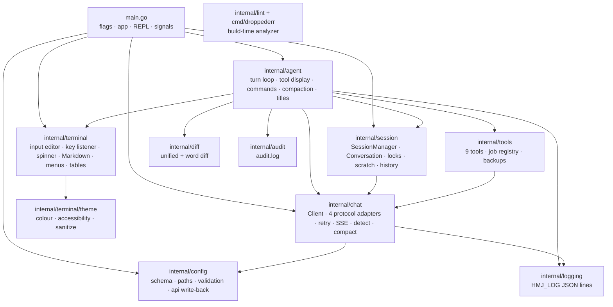

### 3.2 Runtime objects

- **`app`** (`main.go`): holds the config, the active `ModelRef`, the `chat.Client`, the `agent.Runner`, the `SessionManager`, a root `ctx` that is cancelled at shutdown, a one-slot `busy` channel held while a turn changes the conversation, and the pending `Compaction`.
- **`Runner`** (`agent/agent.go`): owns the tool set and its definitions, and runs a turn.
- **`Client`** (`chat/chat.go`): one HTTP transport (no total timeout, HTTP/2, TLS ≥ 1.2, **redirects never followed**, compression off). It also holds the retry policy and the memory of detected protocols.
- **`Jobs`** (`tools/background_jobs.go`): a registry of background shell jobs for the whole process, keyed by owner (the conversation's scratch directory).

---

## 4. Data model

### 4.1 Transcript (`chat/chat.go`)

| Type | Fields | Notes |
|---|---|---|
| `Message` | `Role` (`system`/`user`/`assistant`/`tool`), `Content`, `ToolCalls`, `ToolCallID`, `Images`, `Blocks` | The format every provider shares. |
| `Block` | `Type`, `Text`, `Signature`, `Data` | Opaque, and MUST be replayed verbatim: `thinking`, `redacted_thinking`, `reasoning`, `compaction`, `responses_compacted_window`, `summary`. |
| `ToolCall` | `ID`, `Function{Name, Arguments(JSON string)}`, `ThoughtSignature` | The Gemini signature is round-tripped. |
| `TokenUsage` | prompt, completion, total and cached tokens (several provider spellings), plus the measured `Duration`, `TTFT`, `FinishReason`, `RefusalCategory`, `Speed` | `EffectiveCachedTokens()` takes the first non-zero alias. |

A **compaction message** is an assistant message whose only content is one compaction block, placed right after the system prompt.

### 4.2 Conversation (`session/session.go`)

`ID` (decimal string), `Name`, `AutoTitled`, `Model{Provider, Model}`, `Messages`, `CreatedAt`, `UpdatedAt`, `LastPromptTokens`, `TokenMarkIndex`, `ArchivedBytes`. `ScratchDir` and `HistoryPath` are worked out from the session directory and are not stored.

Token estimate: if the provider reported a prompt size, the estimate is `LastPromptTokens + bytes(messages[TokenMarkIndex:]) / 4`. Otherwise it is `bytes(all) / 4`.

### 4.3 Files on disk

```text
~/.hmj/                         (HMJ_CONFIG moves config.json; its directory is the data dir)
├── config.json                 0600, written from config.example.json on first run
├── audit.log, audit.log.1      one JSON line per tool run; rotates at 10MB (HMJ_AUDIT_LOG / "off")
├── backups/                    previous content of edited/written files (200 files / 256MB)
├── fetch/                      full text of truncated fetch_url pages (100 / 256MB)
├── commands/                   full output of truncated run_command runs (100 / 256MB)
├── images/                     tool-result pictures by SHA-256 (500 / 1GB)
└── projects/<slug>-<hash12>/   session dir (HMJ_SESSIONS overrides)
    ├── state.json              {activeId, defaultModel, lastId}
    ├── conversations/<id>.json one file per conversation, compact JSON
    ├── conversations/<id>.lock OFD lock file holding the holder's PID
    ├── conversations/<id>.json.corrupt*  set-aside damaged copies (≤ 5)
    ├── scratch/<id>/           $HMJ_SCRATCH; jobs/ holds background job logs
    └── history/<id>.jsonl      messages replaced by compaction, for /history
```

The project slug is the base name of the nearest ancestor with a `.git` entry (or of cwd), sanitized, then `-` and 6 bytes of the SHA-256 of the real path (`config/config.go:192`).

---

## 5. Process flows

### 5.1 Startup

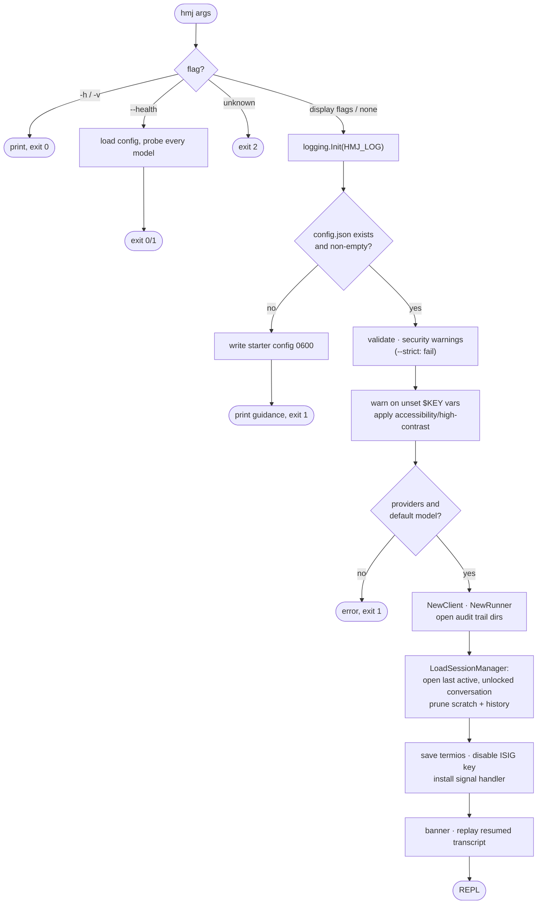

**Verified by:** `main_test.go` (flags and exit codes, config validation, `--strict`, display-mode precedence, a model that is no longer configured), `e2e/first_run_config_test.go` (starter config written, empty config filled, invalid config reported and not replaced), `e2e/e2e_test.go` `TestStartupAndCtrlDExit`, `internal/session/session_test.go` `TestLoadSessionManagerRecoversInvalidActiveID` (startup opens a usable conversation), `internal/session/manager_test.go` (guidelines capped at 160 lines, `AGENTS.md` before `README.md`).

### 5.2 REPL and dispatch

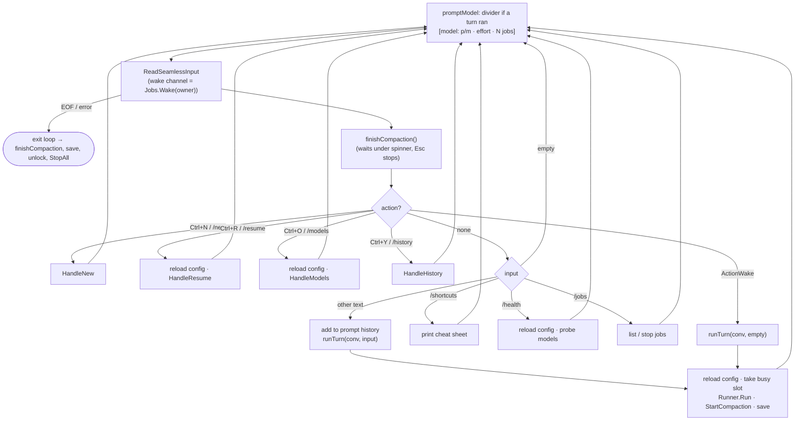

Rules:
- Config is **reloaded** before every turn, `/resume`, `/models` and `/health`, guarded by mtime and size (`main.go reloadConfig`). A file that is missing or invalid keeps the current config. A file rejected by `--strict` is reported once.
- If the conversation's model is no longer configured, it falls back to the config's default model before the prompt prints.
- Any text that is not exactly a known slash command goes to the model, including paths such as `/etc/hosts`.

**Verified by:** `main_test.go` (config reload skipped when the file is unchanged, swapped when it changes, invalid or deleted file keeps the current config; empty input ignored; failed commands reported; prompt falls back when the model is removed), `e2e/e2e_test.go` (`TestSlashMenu`, `TestConfigHotReload`, `TestConversationManager`, `TestModelSwitchIsStickyAcrossRestarts`, `TestTurnHistoryBrowser`), `e2e/background_jobs_test.go` `TestBackgroundJobWakesTheIdlePrompt`.

### 5.3 One turn (`Runner.Run`)

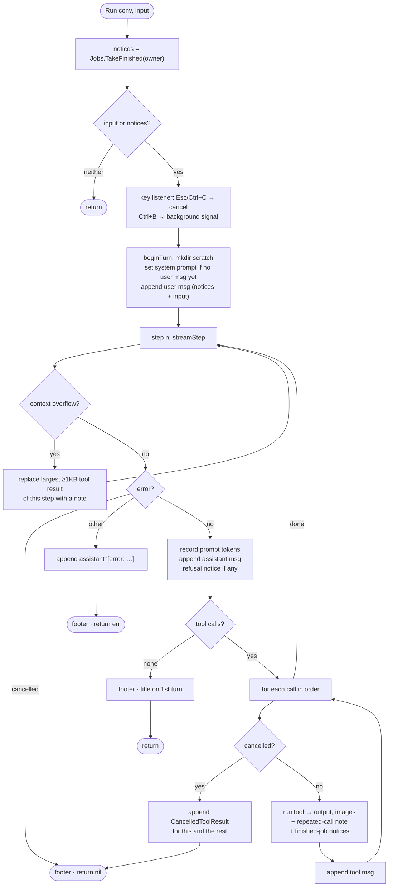

Invariants:
- After any exit, every `ToolCall` of the last assistant message has a matching `tool` message (`CancelledToolResult` = `[cancelled by user before this tool ran]`).
- The footer is printed on every exit, a failed turn included, whenever any step reported usage.
- A tool result removed for overflow **stays removed** even if the retry fails, so the saved conversation can be sent again. Only results of the current step can be removed. The model never saw them, so earlier thinking blocks stay valid.
- Titles: after the first turn ends normally, and while the name is still automatic and the conversation is not compacted, a separate request (no tools, no retries, short output, 8s timeout, `agent/title.go:34`) writes a 3–6 word title. A failure keeps the automatic name.

**Verified by:** `internal/agent/runner_test.go` (single turn, tool-call loop, halt, tool errors), `internal/agent/halt_answers_tool_calls_test.go` (every tool call is answered after a halt), `internal/agent/oversized_tool_results_test.go` (largest result of the step removed and retried; removal kept when the retry still fails; 320KB cap), `internal/agent/turn_status_line_and_failed_turn_footer_test.go` (footer on a failed turn), `internal/agent/title_test.go` (title only after the first turn, failure keeps the automatic name, timeout), `internal/agent/refusal_and_provider_notices_test.go`, `e2e/ctrl_c_test.go` and `e2e/e2e_test.go` (halt while streaming, while waiting for the first token, during a tool).

### 5.4 Streaming one step (`streamStep`)

The step is one `Client.StreamChat` call, and its callbacks drive a small display state machine:

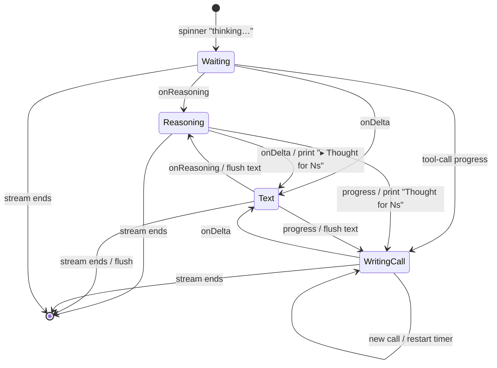

- Reasoning text is shown only in the status line (its latest sentence). The transcript keeps just `▸ Thought for Ns`, timed from the request or from the last answer text.
- Answer text is sanitized, then rendered as Markdown line by line (headings, lists, quotes, rules, tables, inline bold, italic and code; fences shown as written). On a terminal it has a 2-column margin and word wrap.
- Each printed block (thought line, run of text, tool call) has exactly one blank line before it. Trailing newlines of the text are held back and printed only if more text follows.
- While a tool call is being written, the status line shows `writing <tool>` and the size of its arguments so far. Anthropic gets `StreamArguments` (fine-grained tool streaming) for `edit_file` and `write_file`.

**Verified by:** `internal/agent/thought_line_test.go` (reasoning collapses to `Thought for Ns`, timed from the request, latest sentence in the status line), `internal/agent/tool_call_writing_test.go` (status line names the tool call being written and its size), `internal/agent/transcript_spacing_test.go` (one blank line between blocks), `internal/chat/anthropic_tool_flags_test.go` (`StreamArguments`), `e2e/markdown_rendering_test.go` (Markdown, margin and wrap), `e2e/streaming_output_rendering_test.go` (control sequences from the model are sanitized, resize while streaming).

### 5.5 Request retries (`chat/retry.go`, `chat/chat.go doStream`)

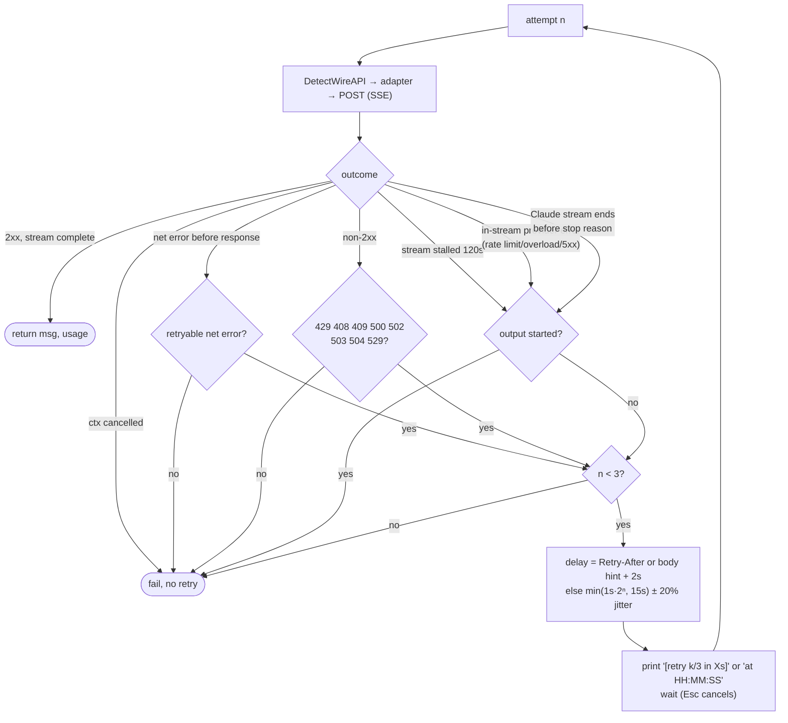

- Server-given waits (a `Retry-After` header, or a body hint such as "try again in 4m39s") MAY go past the 15s backoff cap, and get no jitter.
- Errors include the provider's request ID when it sends one. A 3xx is reported as an error and never followed, so a key never reaches another host.
- Up to 1MB of a non-2xx body is read to build the error.

**Verified by:** `internal/chat/client_test.go` (retry on 429 and 500, no retry on other 4xx), `internal/chat/retry_test.go` (status codes, `Retry-After`, rate-limit body hints, retryable network errors), `internal/chat/stream_error_paths_test.go` (server wait plus 2s buffer, `Esc` during the wait), `internal/chat/stream_resilience_test.go` (stall aborted at the idle timeout and retried only before output), `internal/chat/anthropic_error_handling_test.go` (overloaded and in-stream errors retried before output, a stream that closes before its stop reason), `internal/chat/redirect_not_followed_test.go`, `internal/chat/rate_limit_hint_fuzz_test.go`.

### 5.6 Protocol detection (`chat/wire_detect.go`)

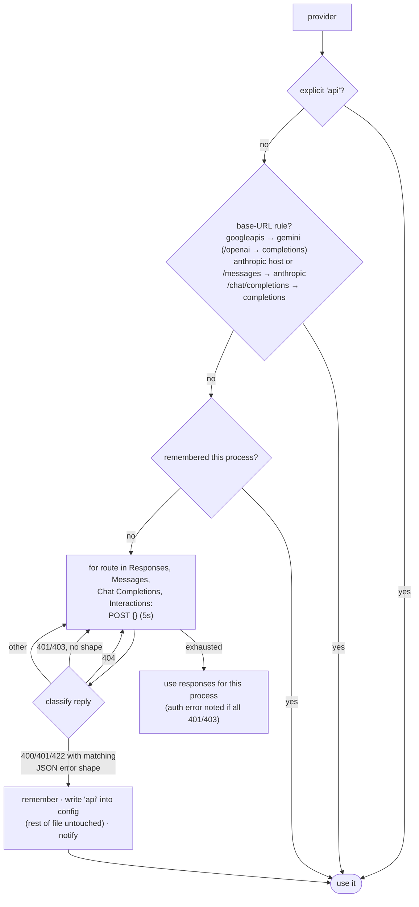

Error shapes: Anthropic `{"type":"error","error":{…}}`. Google `{"error":{"code":<number>,…}}`, which may be wrapped in an array. OpenAI `{"error":{"message":…}}`. FastAPI `{"detail":…}`. The probe never runs again for a provider once its `api` has been saved.

**Verified by:** `internal/chat/wire_detect_test.go` (probe order, error-shape classification, URL rules send no request, one probe per provider per process, a no-match result remembered, detected `api` saved to the config and still used when the save fails), `internal/config/wire_api_and_paths_test.go` and `internal/config/provider_api_write_test.go` (URL inference, rewriting only the provider's `api`).

### 5.7 Tool execution (`Runner.runTool`)

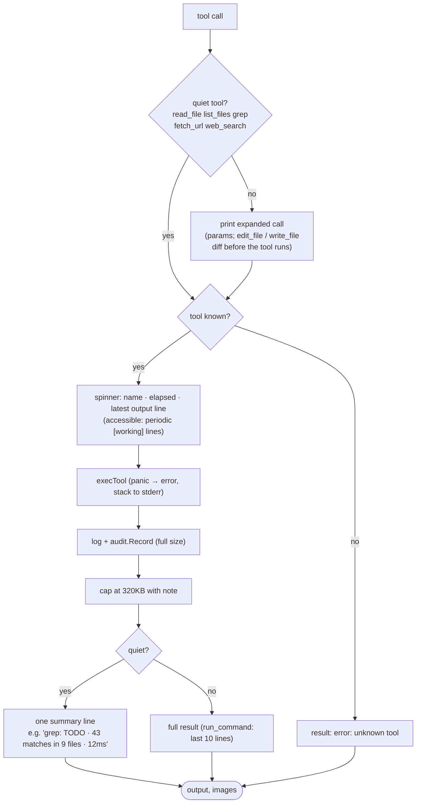

- A tool error is turned into the text `error: <msg>` for the model. It never ends the turn.
- If a call's name, arguments and result all match the previous call's (and it returned no images), the result gets `[note: this call and its result are the same as your previous tool call's]`.
- `Ctrl+Y` / `/history` always shows the full call and result.

**Verified by:** `internal/agent/turn_footer_and_tool_output_test.go` (unknown tool answered with an error), `internal/agent/runner_test.go` `TestToolPanicRecoveryInRunner`, `internal/agent/oversized_tool_results_test.go` `TestToolResultIsCapped`, `internal/agent/repeated_call_test.go`, `internal/agent/tool_result_summary_test.go` (one-line summaries of quiet tools), `internal/agent/edit_call_display_test.go` and `internal/agent/write_call_display_test.go` (diff before the tool runs: overwrite, new file, unchanged content, a file over the size limit, none in a resumed transcript), `internal/audit/audit_test.go`, `e2e/tool_status_line_test.go` (latest output line of a running command).

### 5.8 Shell commands and background jobs

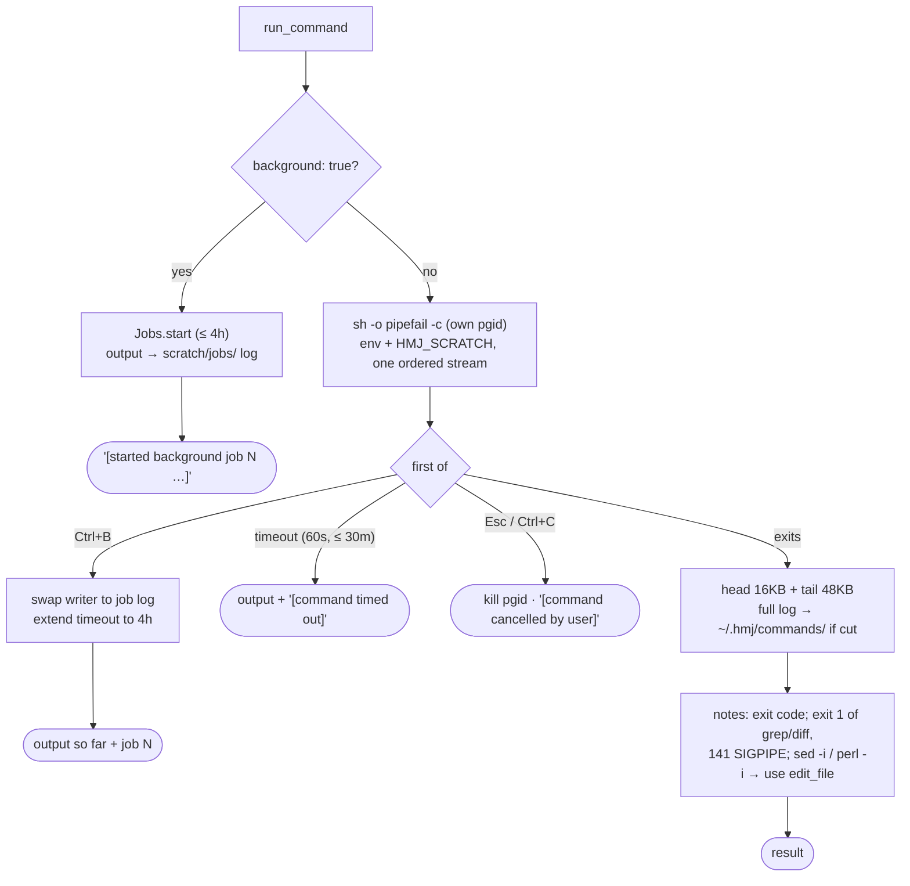

How a finished job reaches the model (owner = conversation scratch dir), whichever comes first:

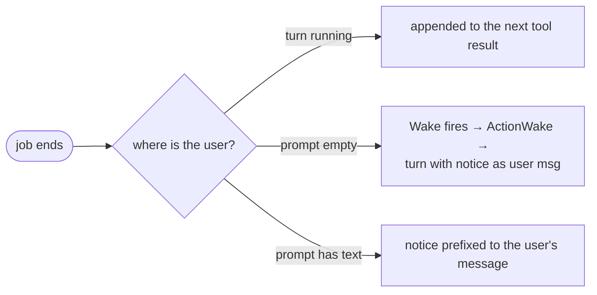

- A notice holds the headline (`exit N` / `timed out` / `stopped`), the last 20 lines (at most 4KB), and the log path.
- `check_command` reports on a job (waits up to 120s for it, shows the last 100 lines / 16KB) or stops it. `/jobs` lists jobs and can stop one.
- The prompt line counts running jobs. Exit and signals stop every job (`Jobs.StopAll`).

**Verified by:** `internal/tools/run_command_output_test.go` (stdout and stderr in order, 16KB head and 48KB tail, full log saved and capped), `internal/tools/run_command_outcomes_test.go` (exit-code notes, timeouts), `internal/tools/run_command_in_place_edit_note_test.go`, `internal/tools/run_command_scratch_dir_test.go` (`$HMJ_SCRATCH`), `internal/tools/tools_test.go` (cancellation kills the process group, `TestRunCommandUserCancellation`), `internal/tools/background_jobs_test.go` (background start returns at once, job outlives the turn, `Ctrl+B` moves a command and lifts its timeout, `check_command` wait cap), `internal/terminal/wake_pipe_test.go` (wake ends an empty prompt), `e2e/background_jobs_test.go` (all three notice paths: idle wake, next tool result, prefix to a typed draft; `/jobs` and exit stop jobs).

### 5.9 Compaction lifecycle

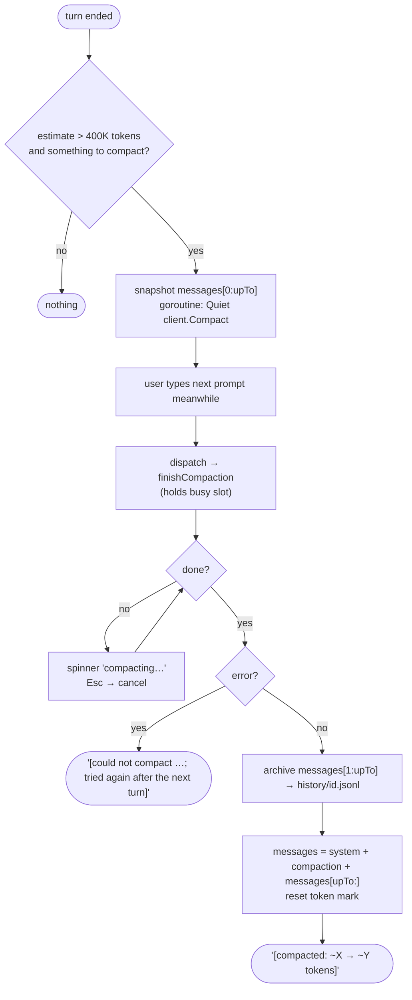

How each protocol compacts (`chat/compaction.go`):

| Protocol | Method | Result block |
|---|---|---|
| Anthropic | the turn's own request plus the on-demand compaction field, so it reads the prompt cache | `compaction` (signed, replayed as is) |
| OpenAI Responses | `POST /responses/compact` | `responses_compacted_window` (opaque items) |
| Chat Completions, Gemini | an ordinary request ending in the summary instruction (tools still defined) | `summary` |
| Any, on HTTP 400/404 | falls back to the summary request | `summary` |

- A turn is **never** compacted mid-way. Requests go out past 400K if they must.
- A compaction block from another protocol is sent as a portable user message (`SummaryPrefix` + text) followed by the reply `SummaryAck`. A Responses window, which cannot be read elsewhere, becomes a fixed "could not be read" note.
- If the conversation shrank meanwhile (`ErrCompactionOutdated`), nothing changes. If archiving fails, the compaction is still applied and a warning is printed.

**Verified by:** `internal/session/compact_test.go` (only over the limit, not for a compaction alone, replaces the compacted messages, refuses a shorter conversation, token estimate from the reported prompt size), `internal/session/history_test.go` (replaced turns kept for `/history`, compaction still applied when the history file cannot be written), `internal/agent/compaction_test.go` (runs after the turn, failure and stop leave the conversation, a halted tool round over the limit), `internal/chat/anthropic_compaction_test.go` and `internal/chat/openai_responses_compact_test.go` (native requests, fallback to a summary on rejection), `internal/chat/compaction_test.go` (a foreign compaction is sent as text by every protocol), `e2e/compaction_test.go`, `e2e/resume_selector_paging_and_halts_test.go` `TestHaltWhileCompacting`.

### 5.10 Sessions and multi-process safety

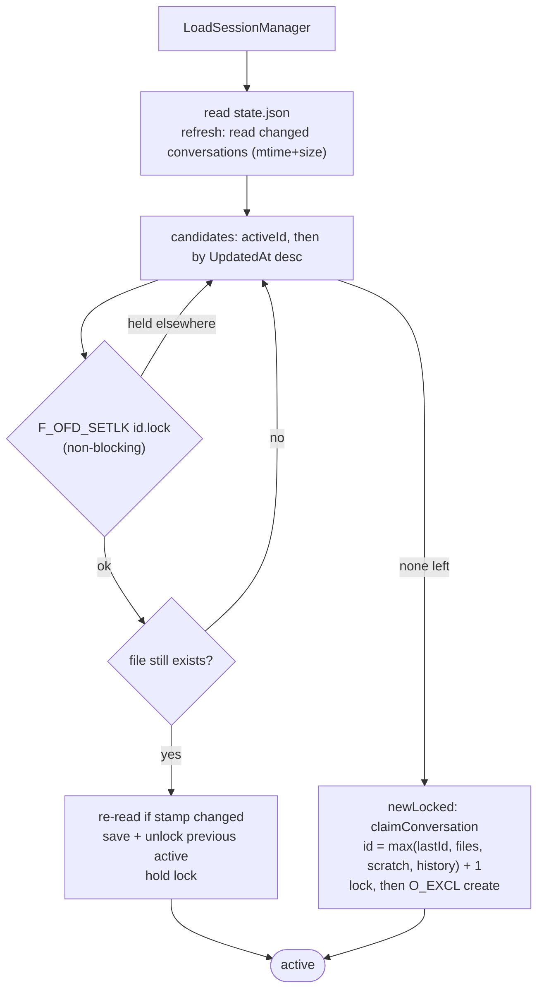

- **Save** writes only the active conversation and `state.json`, atomically (temp file, `fsync`, rename, mode 0600). Other conversations are written when they change (created, renamed, deactivated).
- **`/resume`** marks conversations locked by another hmj as `[open in another hmj]` and MUST NOT open, rename or delete them.
- A conversation file that cannot be parsed is renamed to `.corrupt` (≤ 5 kept), and startup goes on.
- **Scratch pruning** at startup: a directory unchanged for 7 days is removed, unless another hmj has its conversation open. An orphan directory (one with no conversation file) is removed after 1 hour.
- Deleting a conversation removes its file, its scratch directory and its history file. Conversation IDs are never reused (`lastId`).

**Verified by:** `internal/session/shared_session_dir_test.go` (two managers share a directory, a conversation open elsewhere is refused, a save never overwrites another manager's conversation, deleted IDs are not reused), `internal/session/manager_test.go` (corrupt file set aside, backups pruned to 5), `internal/session/session_file_recovery_test.go` (save failures leave no temporary files, unreadable files skipped), `internal/session/scratch_test.go` (scratch pruning), `e2e/two_instances_share_sessions_test.go`, `e2e/corrupt_session_recovery_test.go`, `e2e/resume_delete_confirmation_test.go`.

### 5.11 Shutdown

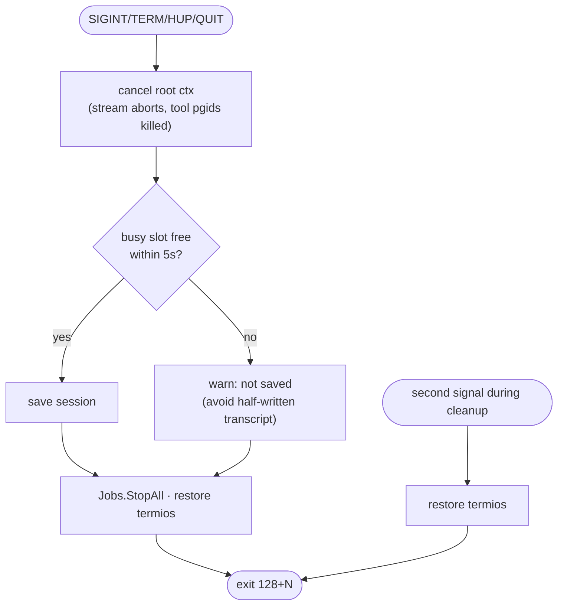

A normal exit (`Ctrl+D` / EOF) finishes any compaction, saves, releases the conversation lock and stops every job.

**Verified by:** `main_test.go` (`TestWaitForTurnRefusesWhileTurnRuns`, `TestSecondSignalExitsAtOnce`, signal exit codes), `e2e/cli_test.go` (signals save the session and exit; a signal during a tool kills the child and saves; `Ctrl+D` exits cleanly), `e2e/ctrl_c_test.go` `TestCtrlCInterruptIsRestoredOnExit`.

---

## 6. Tools

Shared rules: paths are resolved by `ResolvePath`, which expands `~`, makes them absolute against cwd and cleans them, with no confinement. Every run is audited. Results are capped at 320KB (`agent/oversized_tool_results.go:16`).

| Tool | Parameters | Behaviour and limits |
|---|---|---|
| `read_file` | `path`, `offset`, `limit`, `numbered` (default true) | Streams lines. Without a `limit`: ≤ 2000 lines and 256KB, with a trailer giving the next `offset`. Files up to 10MB. A directory returns its listing. PNG, JPEG, GIF and WebP come back as an image (≤ 2000px a side, ≤ 3.75MB encoded). Other binary files get a one-line description. |
| `edit_file` | `path`, `old_string`, `new_string`, `replace_all`, `ignore_whitespace`, or `edits[]` | `old_string` must be unique unless `replace_all`. `edits` apply in order, **all or none** (`edit k of n: …; no edits were made`). An edit that changes nothing is skipped with a note. The old content is backed up first. `.go` / `.json` files get a quick syntax check (warning only). The display shows a unified diff with word-level highlights. |
| `write_file` | `path`, `content` | Creates parent directories. Content ≤ 10MB. Backs up the old content. Same syntax check. The display shows a diff against the current file (all lines added for a new file; none for a file over 10MB or one that cannot be read; a note when the content is unchanged), capped at 120 rows like `edit_file`'s. |
| `list_files` | `path`, `recursive`, `max_depth`, `pattern` (glob such as `**/*Test.kt`) | Recursive. Skips `.git` and anything `.gitignore` ignores. ≤ 300 results. |
| `grep` | `pattern`, `literal`, `case_insensitive`, `path`, `glob`, `output_mode` (`files_with_matches` default / `content` / `count`), `context` (≤ 20), `head_limit` (default 250, ≤ 2000) | Pure-Go regex. Honours `.gitignore`, skips binary files. Output ≤ 64KB, lines cut at 500 bytes. |
| `run_command` | `command`, `workdir`, `timeout_seconds` (60s, ≤ 1800), `background` | See §5.8. Output ≤ 64KB (16KB head + 48KB tail). Logs ≤ 64MB each. |
| `check_command` | `job`, `wait_seconds` (≤ 120), `stop` | Reports on or stops a background job. |
| `web_search` | `query`, `limit`, `allowed_domains`, `blocked_domains`, `recency` (day…year) | DuckDuckGo HTML, then Brave, then Bing result pages, then DDG instant answers, then a Wikipedia search. 15s timeout. 15-minute cache (100 entries). Results name their source and today's date. |
| `fetch_url` | `url`, `max_lines` (120, ≤ 1000), `timeout_seconds` (20, ≤ 120) | Sends `Accept: text/markdown` first. HTML → text, keeping `<main>`/`<article>`. GitHub blob pages → raw file. base64 `?format=TEXT` decoded. JSON indented. Body ≤ 16MB, output ≤ 64KB, ≤ 10 redirects (a cross-host one is noted). A page that is cut short is saved to `~/.hmj/fetch/`. Public pages cached 15 minutes (64 pages / 16MB). Localhost is allowed and never cached. |

The system prompt tells the model to use the file tools rather than shell `sed`/`cat`/heredocs, to start commands longer than about 2 minutes in the background and end its turn, and to verify its work before declaring it done. It also says that tool output is information, not instructions.

---

## 7. Configuration

```jsonc
{
  "accessibility": false,
  "highContrast": false,
  "providers": {
    "<name>": {
      "baseUrl": "https://…",
      "api": "responses | completions | anthropic | gemini",   // optional; probed if absent
      "apiKey": "$ENV_VAR or literal",
      "models": [
        { "id": "<model-id>", "name": "label", "maxOutputTokens": 64000,
          "effort": "low|medium|high|xhigh|max", "thinking": "adaptive|off", "speed": "fast" }
      ]
    }
  }
}
```

- **Default model**: the first model of the provider whose name sorts first (`config.DefaultModel`), unless `state.json` holds a sticky default. `/models` changes the active conversation's model and the sticky default.
- **Validation**: `effort`, `thinking` and `speed` must be one of their listed values. An empty file counts as missing (a starter config is written).
- **Security warnings** (`config.SecurityWarnings`): a literal key in a file other users can read, and a key sent over plain `http://` to a host that is not loopback. These are warnings normally, and fatal or reload-rejecting under `--strict`.
- **Env**: `HMJ_CONFIG`, `HMJ_SESSIONS`, `HMJ_LOG`, `HMJ_AUDIT_LOG` (path or `off`), `HMJ_VERSION` (installer), `NO_COLOR`, `FORCE_COLOR`, `CLICOLOR_FORCE`, `ACCESSIBILITY`, `HIGH_CONTRAST`.

### 7.1 How model settings map to each protocol

| Setting | Anthropic | Responses | Chat Completions | Gemini |
|---|---|---|---|---|
| `maxOutputTokens` | always sent, default 64000 | `max_output_tokens` if set | `max_tokens` if set | `max_output_tokens` if set |
| `effort` | `output_config.effort` (sent even when thinking is off) | `reasoning.effort` | not sent (label says so) | low/medium kept; high, xhigh, max → `high` |
| `thinking: adaptive` | `thinking: {type: adaptive, display: summarized}` | reasoning summary + encrypted content | — | thinking on |
| `thinking: off` | no thinking field | no reasoning fields | — | — |
| `speed: fast` | `speed: "fast"`; footer reports the steps that ran fast | ignored | ignored | ignored |

---

## 8. Provider adapters

| | Anthropic | OpenAI Responses | Chat Completions | Gemini Interactions |
|---|---|---|---|---|
| Endpoint | `POST /v1/messages` | `POST /responses` | `POST /chat/completions` | `POST /v1beta/interactions` |
| Reasoning replay | `thinking` / `redacted_thinking` blocks with signatures | `reasoning` items (ID + encrypted content) | none | `thought_signature` on function calls |
| Prompt caching | 3 breakpoints: end of system, last tool, last non-thinking block of the last message | automatic | automatic | automatic |
| Images in tool results | yes | yes | replaced by a note | yes |
| Compaction | native on-demand | `/responses/compact` | summary | summary |
| Refusal | `stop_reason: refusal` + category → notice | — | — | — |

All request bodies are encoded with **map keys sorted** (`json.Deterministic`), so tool schemas and replayed arguments come out byte-identical from run to run and the cache prefix stays stable. Tool schemas keep a declared property order (`chat.PropertyOrder`).

---

## 9. Terminal and UX requirements

- **Input editor**: raw-mode line editor with bracketed paste (multi-line pastes never submit early), drag-and-drop path unquoting (`'…'`, `"…"`, `\ `, `file://`), wide-character layout, history with `↑`/`↓` that keeps the draft, shell editing keys, and OSC 133 prompt marks. `/` at an empty prompt opens a searchable command palette.
- **Key listener during a turn**: termios with `ICANON|ECHO|ISIG` off, polling at 50ms. `Esc`/`Ctrl+C` halt and `Ctrl+B` moves the running command to the background. A key pressed after the turn ends belongs to the next prompt.
- **Status line**: elapsed time, step N, `X in · Y out · Z tokens/s`, the current label (thinking…, writing tool, tool call line), and a detail (latest reasoning sentence, argument size, or latest output line). It shows `Ctrl+B: background` while a foreground `run_command` runs.
- **Footer**: `[tokens: input (cached) · output · total [steps] · tokens/s · fast mode … · Ns total (TTFT) , done at HH:MM]`, plus a truncation warning when `finish_reason = length`. It is followed by a blank line and a dim divider before the next prompt.
- **Halt notice** names the key that stopped the turn, printed after whatever the stopped step printed.
- **Accessibility mode** (`--accessible`, `ACCESSIBILITY=1`, config): append-only output with no cursor movement. `[working]` lines replace the spinner, menus are numbered lists (`r <n> <name>`, `d <n>`, `q`), a line ending in `\` continues the input, slash commands replace shortcuts, results come in `[RESULT name]` blocks with remediation hints, ASCII borders, and `[OK]`/`[NOTE]`/`[ERROR]` badges.
- **High contrast**: bright and bold, no dim text, removed lines underlined, bold `+`/`-`.
- **Colour**: off with `NO_COLOR` (any value) or `--no-color`. Forced into a pipe with `FORCE_COLOR` / `CLICOLOR_FORCE`.
- **Clipboard** (`/history` copy): OSC 52 first (works over SSH), else `wl-copy`, `xclip` or `xsel`. Copies stay raw Markdown.

| Shortcut | Command | Action |
|---|---|---|
| `Ctrl+N` | `/new` | new conversation (keeps the model) |
| `Ctrl+R` | `/resume` | conversation manager: switch, `Ctrl+E` rename, `Ctrl+D` delete (asks to confirm) |
| `Ctrl+O` | `/models` | model selector with filter |
| `Ctrl+Y` | `/history` | browse turns (compacted ones marked) and copy a prompt, response, tool actions or a whole turn |
| `Ctrl+B` | — | move the running command to the background |
| `Esc` / `Ctrl+C` | — | halt |
| `Ctrl+D` | — | exit |
| — | `/jobs`, `/health`, `/shortcuts` | jobs, provider health, cheat sheet |

---

## 10. Limits and constants

| Constant | Value | Source |
|---|---|---|
| Compaction threshold | 400,000 tokens (estimate) | `session/compact.go:14` |
| Stream idle timeout | 120s | `chat/chat.go:380` |
| Retries | 3; backoff 1s × 2ⁿ, cap 15s, ±20% jitter; +2s on server waits | `chat/retry.go:29` |
| Tool result cap | 256KB + 64KB = 320KB | `agent/oversized_tool_results.go:16` |
| Min result removed on overflow | 1KB | `agent/oversized_tool_results.go:19` |
| read_file | 2000 lines / 256KB per call; 10MB file | `tools/tool.go:16-24` |
| edit/write size | 10MB | `tools/tool.go:18-20` |
| run_command output | 64KB (16KB head + 48KB tail); log ≤ 64MB | `tools/tool.go:26`, `tools/run_command_output.go:18,30` |
| run_command timeout | 60s default, 30 min max | `tools/run_command.go:108`, `tools/tool.go:29` |
| Background job max | 4h | `tools/background_jobs.go:21` |
| Finish notice | 20 lines / 4KB | `tools/background_jobs.go:26` |
| check_command wait | ≤ 120s | `tools/check_command.go:15` |
| fetch_url | body 16MB, output 64KB, 120 lines (≤ 1000), 20s (≤ 120s), 10 redirects, cache 15 min | `tools/tool.go:33-35`, `tools/fetch_url.go:71-77`, `tools/fetch_url_page_cache.go:15` |
| grep | head 250 (≤ 2000), context ≤ 20, line 500B | `tools/grep.go:24-28` |
| list_files | 300 results | `tools/list_files.go:22` |
| Images | 2000px side, 3.75MB, 50MP, file 64MB; store 500 | `tools/read_image.go:19-27`, `chat/images.go:33` |
| Backups | 200 files / 256MB | `tools/backup.go:17-18` |
| Command logs / fetch saves | 100 files / 256MB each | `tools/run_command_output.go:22-23`, `tools/fetch_url_output_limit.go:16-17` |
| Scratch idle / orphan | 7 days / 1 hour | `session/scratch.go:17,20` |
| Corrupt backups | 5 | `session/conversation_files.go:123` |
| Guidelines | 160 lines | `session/session.go:27` |
| Title request | 8s | `agent/title.go:34` |
| Shutdown grace | 5s | `main.go:86` |
| Protocol probe | 5s per route | `chat/wire_detect.go` |

---

## 11. Observability

- **Audit log** (default on): one JSON line per tool run with tool, arguments, duration, output size and error. Rotates at 10MB.
- **Diagnostic log** (`HMJ_LOG`, opt-in, JSON lines): tool runs (arguments cut to 1000B), LLM steps (tokens, cached, TTFT, finish reason, speed), retries, HTTP responses (status, protocol, request ID, Anthropic org/workspace), protocol probes, config reloads, session saves, compactions, tool panics.
- **`--health` / `/health`**: probes each configured model for latency and errors.

---

## 12. Verification strategy

| Layer | How | Command |
|---|---|---|
| Unit | tests next to each package, shuffled | `make test` |
| Static | `cmd/droppederr` (no dropped errors), nilness, deadcode, vet | `make check` |
| End-to-end | built binary in a pty against a scripted mock provider; the screen is checked with a built-in terminal emulator (self-tested) | `make e2e` |
| Live | one real turn against a configured provider | `make e2e-live` |
| Fuzz | Markdown tables, key input, drag paths, diff, rate-limit hints | `make fuzz` |
| Race | repeated `-race` runs | `make race` |
| Benchmarks | SSE, request encoding, session save, diff, Markdown | `go test -bench` |

Behaviours the e2e suite pins: first-run config, Ctrl+C halt, background jobs, compaction, recovery from a corrupt session, `/resume` delete confirmation and paging, two instances sharing sessions, accessible screens, high contrast, clipboard copy, Unicode and paste, Markdown streaming, the tool status line, the install script.

---

## 13. Security model

hmj is an **unrestricted** agent. Its safety comes from the environment it runs in, not from the program.

- Run it inside a dedicated VM. Mount the project in, and keep git credentials, SSH and GPG keys on the host. Review `git diff` on the host before committing.
- Nothing is masked: session files, logs and errors keep credentials exactly as seen.
- Mitigations that do exist: redirects are never followed (a key reaches only `baseUrl`), there are `--strict` config checks, terminal output is sanitized, and the system prompt says tool output is data, not instructions.

---

## 14. Known limitations

- A model whose context window is under 400K is not compacted any earlier. A long conversation on it can fail on size, and then the user starts a new one with `Ctrl+N`.
- The token estimate between provider reports is 4 bytes per token, which is low for code.
- After compaction the model sees only the summary. Images in replaced turns survive only as the summary describes them.
- A conversation is single-writer: a second hmj in the same project starts its own conversation instead of joining the open one.
- `web_search` scrapes public result pages and can break when those pages change their markup.
